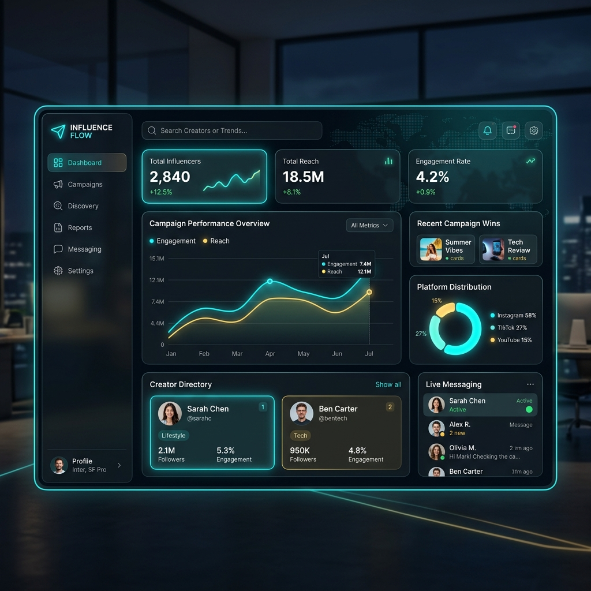

# ⚡ AutoSocial

<div align="center">



### **Intelligent Social Media Automation, Campaign Analytics & AI-Powered Viral Content Engine**

[](https://fastapi.tiangolo.com)
[](https://nextjs.org)
[](https://react.dev)
[](https://www.postgresql.org)
[](https://github.com/facebookresearch/faiss)
[](https://www.typescriptlang.org)
[](https://www.python.org)

[Explore Features](#-core-features) • [System Architecture](#-system-architecture) • [How Viral LLM Works](#-how-the-ai--rag-engine-works) • [Quick Start](#-quick-start-guide) • [API Reference](#-api-endpoints)

</div>

---

## 📖 What is AutoSocial? (In 30 Seconds)

**AutoSocial** is an end-to-end creator economy and campaign automation platform. It bridges the gap between **brands running promotional campaigns** and **creators publishing short-form content** (Instagram Reels, TikTok, YouTube Shorts, X/Twitter).

Instead of manual spreadsheets and guessing what content will perform:
1. **Brands create campaigns** with automated payout models (per-million views or pot split).
2. **Creators connect social accounts** and verify ownership via bio-token verification.
3. **AI Content Studio (Viral LLM)** leverages **Retrieval-Augmented Generation (RAG)** over a vector database of top-performing viral reels to generate, structure, and score high-engagement hooks, captions, and hashtags.
4. **Automated Submission & Metric Tracking** ingests submitted links and calculates live view and engagement metrics directly from social platforms.
5. **Real-Time Communication** allows instant creator-brand coordination via WebSocket ticket chats.

---

## ✨ Core Features

### 1. 🤖 Viral LLM & RAG Engine
* **Semantic Vector Retrieval:** Uses `sentence-transformers` and **FAISS** (`viral_index.faiss`) to find historical viral posts matching the user's topic and target audience.
* **Pre-Publication Virality Scoring:** Evaluates opening hooks using statistical scoring algorithms before publishing.
* **Modular Generation:** Separate AI prompt pipelines for:
  * 🎯 **Hooks:** Curiosity gaps & pattern interrupts.
  * 📝 **Captions:** Structured, reader-friendly body copy.
  * #️⃣ **Hashtags:** High-volume & niche-targeted tags.
  * 📣 **Calls-to-Action (CTA):** Conversion & follower-focused prompts.

### 2. 📱 Multi-Platform Social Ingestion
* Connects accounts across **Instagram**, **TikTok**, **YouTube**, and **X (Twitter)**.
* **Automated Bio Verification:** Prevents account impersonation by requiring creators to add a short random verification token to their profile bio before linking.
* **Automated Video Scraping & Sync:** Fetches views, likes, and comment counts to automatically audit campaign performance.

### 3. 🎯 Campaign & Promotion Management
* **Flexible Compensation Models:** Support for "Per-Million Views" (pay per reach) and "Prize Pot" (split pool).
* **Creator Applications:** Creators submit join requests with their linked accounts; campaign owners can approve, reject, or moderate members.
* **Submission Logging:** Anti-cheat mechanisms prevent duplicate link submissions across campaigns.

### 4. 💬 Real-Time Support Tickets & Live Chat
* **WebSocket-Powered Chat:** Instant real-time messaging between creators and campaign managers.
* **Ticket Tracking:** Categorized support requests with unread notification badges and image attachment uploads.

### 5. 🔐 Enterprise-Grade Authentication
* **Email & Password + OTP:** 5-digit verification codes dispatched via SMTP.
* **Google OAuth 2.0:** One-tap sign-in with server-side token signature verification via `google-auth`.
* **Stateful Sessions:** 30-day encrypted session middleware with real-time `last_active` tracking.

---

## 🏗️ System Architecture

```
                                  ┌───────────────────────────────┐
                                  │   Creator / Brand Browser     │
                                  └───────────────┬───────────────┘
                                                  │
                                  ┌───────────────┴───────────────┐
                                  ▼                               ▼
                     ┌────────────────────────┐      ┌────────────────────────┐
                     │ Next.js 15 (Port 3000) │      │  Jinja2 SSR (Fallback) │
                     │ React 19 + TypeScript  │      │  HTML5 + Modern CSS    │
                     └────────────┬───────────┘      └────────────┬───────────┘
                                  │                               │
                                  └───────────────┬───────────────┘
                                                  │ REST APIs & WebSockets
                                                  ▼
                     ┌────────────────────────────────────────────────────────┐
                     │              FastAPI Backend (Port 8000)               │
                     │  - Lifespan & Windows Proactor Event Loop Policy       │
                     │  - Asynchronous ConnectionManager (WebSockets)         │
                     │  - Session & Request Logging Middleware                │
                     └───────┬────────────────────┬───────────────────┬───────┘
                             │                    │                   │
             ┌───────────────┴──────┐             │       ┌───────────┴───────────────┐
             ▼                      │             ▼       ▼                           ▼
┌──────────────────────────┐        │     ┌──────────────────┐    ┌───────────────────────────┐
│     PostgreSQL DB        │        │     │  Viral LLM & RAG │    │   Social Platform APIs    │
│ - app_users              │        │     │ - Sentence Trans.│    │ - Instagram Scraper       │
│ - registered_accounts    │        │     │ - FAISS Vector DB│    │ - TikTok Ingestion        │
│ - promotions & joins     │        │     │ - Hook Scorer    │    │ - YouTube Data API v3     │
│ - submitted_shorts       │        │     │ - LLM Generation │    │ - Twitter / X API         │
│ - ticket_messages        │        │     └──────────────────┘    └───────────────────────────┘
└──────────────────────────┘        │
                                    ▼
                         ┌──────────────────────┐
                         │   SMTP Mail Server   │
                         │ (Verification Codes) │
                         └──────────────────────┘
```

---

## 🧠 How the AI & RAG Engine Works

```
 User Topic & Goal 
        │
        ▼
 [1. Text Embedding] ────────► sentence-transformers (all-MiniLM-L6-v2)
        │
        ▼
 [2. Vector Retrieval] ──────► FAISS Index (Searches top-k similar viral reels)
        │
        ▼
 [3. Augmented Context] ─────► Injects viral patterns, hooks & structure into Prompt
        │
        ▼
 [4. LLM Generation] ────────► Generates candidate hooks, captions & CTAs
        │
        ▼
 [5. Hook Scoring] ──────────► ML scorer evaluates hook strength (Accept or Regenerate)
        │
        ▼
 High-Converting Post Ready to Publish!
```

---

## 📁 Repository Directory Structure

```
webapp/
├── core/                         # Core backend domain logic & platform services
│   ├── config.py                 # Database credentials and API configurations
│   ├── database.py               # Database schemas, migrations & query functions
│   ├── instagram.py              # Instagram video fetching & profile scraping
│   ├── instagram_bio.py          # Bio verification scraper for Instagram
│   ├── tiktok.py                 # TikTok video data extraction
│   ├── tiktok_bio.py             # TikTok bio verification
│   ├── twitter.py                # X / Twitter video ingestion
│   ├── twitter_bio.py            # Twitter bio verification
│   ├── youtube.py                # YouTube Data API video statistics
│   ├── youtube_bio.py            # YouTube channel bio verification
│   ├── verification.py           # Verification code generators & checks
│   └── platform_utils.py         # Link normalization and URL helpers
│
├── frontend/                     # Modern Next.js React frontend
│   ├── app/                      # Next.js App Router
│   │   ├── login/                # Sign-in page with Google OAuth
│   │   ├── signup/               # Registration page with OTP verification
│   │   ├── promotions/           # Campaign discovery & category filters
│   │   ├── promotion-detail/     # Promotion dashboard, join flow, tickets & chat
│   │   └── page.tsx              # Modern dark-mode landing & analytics showcase
│   ├── components/               # Modular UI components & navigation bars
│   ├── context/                  # React Contexts (AuthContext, ThemeContext)
│   ├── lib/                      # API client & fetch wrappers
│   └── package.json              # Frontend npm dependencies
│
├── viral_llm/                    # AI Content Generation & RAG Engine
│   ├── app.py                    # FastAPI microservice for viral post generation
│   ├── generation/               # Targeted prompt engineering modules
│   │   ├── hooks.py              # Opening hook generation
│   │   ├── caption.py            # Body copy generator
│   │   ├── hashtags.py           # Hashtag optimization
│   │   └── cta.py                # Call-to-action generator
│   ├── rag/                      # RAG components
│   │   ├── build_index.py        # Pipeline to embed viral dataset into FAISS
│   │   ├── retriever.py          # Vector similarity search over FAISS
│   │   └── viral_index.faiss     # Pre-computed dense vector index
│   └── scoring/                  # Predictive models
│       └── hook_score.py         # Statistical hook virality evaluation
│
├── templates/                    # Jinja2 HTML templates (Fallback UI)
├── static/                       # Static media, CSS, logos, and uploads
├── main.py                       # Main FastAPI backend, WebSocket manager & API endpoints
├── req.txt                       # Python dependencies
└── README.md                     # Comprehensive project documentation
```

---

## 🛠️ Tech Stack Breakdown

| Layer | Technology | Purpose |
|---|---|---|
| **Backend Framework** | **FastAPI** (Python 3.10+) | Asynchronous, high-throughput REST API & WebSockets |
| **Web Server** | **Uvicorn** | Lightning-fast ASGI server |
| **Frontend Framework** | **Next.js 15 (React 19)** | Server-side rendering, App Router, responsive SPA |
| **Styling** | **Tailwind CSS & Modern CSS** | Sleek luxury dark-mode theme |
| **Database** | **PostgreSQL** + `psycopg2` | ACID-compliant relational data store with connection pooling |
| **Vector Database** | **FAISS (CPU)** | High-speed semantic similarity search for RAG |
| **Embeddings** | **Sentence-Transformers** | Text-to-dense-vector representation |
| **Authentication** | **Google Identity Services + SMTP** | Google OAuth 2.0 & custom email verification codes |
| **Real-Time** | **WebSockets** | Live ticket messaging & status broadcasts |

---

## 🚀 Quick Start Guide

### Prerequisites
- [Python 3.10+](https://www.python.org/downloads/)
- [Node.js 18+](https://nodejs.org/)
- [PostgreSQL](https://www.postgresql.org/download/) running locally or in cloud (Supabase, Neon, AWS RDS)

---

### Step 1: Clone the Repository
```bash
git clone https://github.com/destroyer929/AutoSocial.git
cd AutoSocial
```

---

### Step 2: Set Up the PostgreSQL Database
Open PostgreSQL (`psql` or pgAdmin) and create the database:
```sql
CREATE DATABASE discord_bot_db;
```
*(All tables, indexes, and schemas will automatically be generated on the first startup of the backend via `initialize_database()`.)*

---

### Step 3: Configure the Backend

1. **Create and activate a virtual environment:**
   ```bash
   # Windows:
   python -m venv venv
   venv\Scripts\activate

   # macOS / Linux:
   python3 -m venv venv
   source venv/bin/activate
   ```

2. **Install Python dependencies:**
   ```bash
   pip install -r req.txt
   ```

3. **Configure Database & Credentials:**
   Ensure `core/config.py` has your local PostgreSQL credentials:
   ```python
   DB_CONFIG = {
       'dbname': 'discord_bot_db',
       'user': 'postgres',
       'password': 'your_password',
       'host': 'localhost',
       'port': '5432'
   }
   ```

4. **Launch the FastAPI Backend:**
   ```bash
   uvicorn main.py:app --reload --host 0.0.0.0 --port 8000
   ```
   * Interactive API Documentation (Swagger): `http://localhost:8000/docs`
   * Alternative Documentation (ReDoc): `http://localhost:8000/redoc`

---

### Step 4: Configure and Run Next.js Frontend

1. **Open a new terminal and navigate to the frontend folder:**
   ```bash
   cd frontend
   ```

2. **Install frontend dependencies:**
   ```bash
   npm install
   ```

3. **Run the development server:**
   ```bash
   npm run dev
   ```
   Open [http://localhost:3000](http://localhost:3000) in your browser to experience the AutoSocial dashboard!

---

## 📡 API Endpoints

### 🔑 Authentication & Users
| Method | Endpoint | Description |
|---|---|---|
| `POST` | `/api/signup` | Registers new user and sends verification OTP email |
| `POST` | `/api/login` | Authenticates credentials and issues session cookie |
| `POST` | `/api/auth/google` | Verifies Google OAuth JWT credential & logs in/provisions user |
| `GET` | `/api/me` | Returns session info of the currently logged-in user |
| `GET` | `/api/logout` | Clears user session cookie |

### 🎯 Campaigns & Promotions
| Method | Endpoint | Description |
|---|---|---|
| `GET` | `/api/promotions` | List active promotions (supports `?q=` search and `?category=`) |
| `GET` | `/api/promotions/{id}/detail` | Complete promotion data (analytics, tickets, joined status) |
| `POST` | `/api/promotions/{id}/join` | Submits a join request for a creator account |
| `POST` | `/api/promotions/{id}/submissions`| Submits a short-form video link for verification |
| `GET` | `/api/my-promotions` | Lists campaigns the logged-in user has joined or created |

### 📱 Social Accounts
| Method | Endpoint | Description |
|---|---|---|
| `GET` | `/api/accounts` | Returns user's linked social accounts (`?platform=all`) |
| `POST` | `/api/accounts/register` | Connects a new social account handle |
| `POST` | `/api/accounts/verify` | Validates profile bio verification code |

### 🤖 AI Viral Studio (`viral_llm`)
| Method | Endpoint | Description |
|---|---|---|
| `GET` | `/health` | Health check endpoint for AI microservice |
| `POST` | `/instagram` | Generates RAG-backed hook, caption, hashtags, and CTA |

### 💬 WebSockets
| Protocol | Endpoint | Description |
|---|---|---|
| `WS` | `/ws/{room_id}` | Live bi-directional chat connection for tickets and campaign alerts |

---

## 🛡️ Security & Production Considerations

1. **Secrets Management:** Environment variables (e.g., database passwords, Google Client Secret, SMTP passwords) are read via environment configurations and strictly excluded from version control via `.gitignore`.
2. **CORS Policy:** FastAPI is configured with restrictive CORS headers allowing only designated origins (e.g. `http://localhost:3000`).
3. **Session Security:** Cookies use `HttpOnly`, customizable `SameSite`, and `Secure` flags for production HTTPS deployment.
4. **Input Sanitization:** Account handles and video URLs are validated with regex and database parameterized queries (`%s`) to prevent SQL Injection.

---

## 🤝 Contributing

Contributions, issues, and feature requests are welcome!
1. Fork the Project
2. Create your Feature Branch (`git checkout -b feature/AmazingFeature`)
3. Commit your Changes (`git commit -m 'Add some AmazingFeature'`)
4. Push to the Branch (`git push origin feature/AmazingFeature`)
5. Open a Pull Request

---

## 📝 License
This project is open-source under the MIT License. Feel free to use, customize, and extend it!
